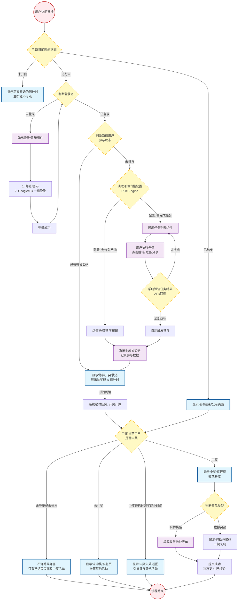

# 抽奖工具 PRD

> 交付深度：原型级
> 产品形态：H5 活动页（手机浏览器打开），由低代码后台配置生成
> 目标市场：海外，暂按英语用户做，见 1.4
> 状态：草稿
> 标记：行尾的 `〔建议〕` 是整理时补充、使用者还没确认的内容；`[待定 Q编号]` 是没定的问题，汇总在附录 A。

# 1. 背景与产品定位

## 1.1 项目背景

在海外市场营销中，抽奖（Giveaway）是获取新用户和提升社群活跃度的低成本高效率手段。然而，目前市面上的抽奖工具要么过于复杂（如 Gleam.io 配置繁琐），要么缺乏信任感（用户担心黑箱操作）。我们基于低代码平台设计一款**轻量级、配置灵活且具备高公信力**的抽奖工具模板（HTML 页面）。

## 1.2 产品定位

- **核心理念**：极简参与、透明公正、社交裂变。
- **对标产品**：微信小程序「抽奖助手」，对标它的 UI 风格与交互体验。
- **目标用户**：
  - **B 端（运营者）**：通过低代码后台快速搭建活动，设置任务门槛（Twitter 关注、Discord 入群等）。
  - **C 端（参与者）**：通过 H5 页面极速参与，体验顺畅，结果可追溯。

## 1.3 核心价值

1. **低门槛**：支持 Google 和 Facebook 一键登录，无缝参与。
2. **高信任**：倒计时、赞助商背书、中奖名单公示。
3. **自增长**：通过任务机制（Tasks）引导用户分享和关注，实现流量裂变。

## 1.4 目标市场

| 项 | 约定 |
|---|---|
| 主市场和次市场 | [待定 Q1] 默认假设：面向英语用户，不限定国家。 |
| 界面语言 | [待定 Q1] 默认假设：只做英语。 |
| 时区和格式 | 后台配置 UTC 时间，前端按用户浏览器的本地时区显示。日期和数字的写法跟随界面语言 〔建议〕 |
| 登录渠道 | 邮箱加密码、Google 一键登录、Facebook 一键登录 |
| 分享和任务渠道 | 任务：YouTube、Facebook、Discord、Twitter、访问官网。分享：系统原生分享面板，或复制专属邀请链接 |
| 支付渠道 | 不涉及 |
| 合规要求 | [待定 Q2] 默认假设：这一版不做 Cookie 同意弹窗和年龄确认，只在【登录注册弹窗】里放用户协议和隐私政策两个链接。 |
| 设备和网络 | 手机浏览器为主 〔建议〕 |

## 1.5 范围和优先级

- **这一版要做**：
  - 活动主页（3.1）：顶部导航、轮播图 Banner 区域、倒计时、赞助商信息展示、活动简述、参与抽奖 CTA 按钮区、任务列表区、参与者列表浮层。
  - 开奖后页面（3.2）：主页各组件的已结束形态、开奖结果弹窗（中奖、未中奖、中奖失效三种视图）、领奖、中奖名单公示。
  - 登录注册弹窗（3.0.1）。
- **这一版简化**：
  - 邀请裂变任务：MVP 阶段简化逻辑，模拟完成状态。
  - 实物奖品领奖表单的地址：原型里用普通输入框，不接 Google Place Autocomplete 〔建议〕
  - 汉堡菜单：只做菜单本身，各菜单项点进去的页面这一版不做 [待定 Q8] 默认假设：菜单项跳转到后台配置的链接。
- **这一版不做**：
  - 多阶梯邀请奖励（邀请 1 人得 1 票，邀请 5 人得 10 票），留作后续扩展。
  - 活动列表页 [待定 Q13] 默认假设：不做这个页面，需要跳过去的按钮改为跳转到后台配置的「更多活动链接」。
  - B 端低代码后台的界面。这份 PRD 只写 C 端页面，后台要提供哪些配置见 4.2 〔建议〕

# 2. 用户流程和状态

## 2.1 用户流程图

流程图在原图上补了四处：活动未开始的分支、已结束后进入开奖结果判断的连线、未登录或未参与的用户的结局、中奖后超过领奖截止时间的结局。其余和原图一致 〔建议〕

## 2.2 状态字典

| 维度 | 状态名 | 判断条件 | 备注 |
|---|---|---|---|
| 活动 | 未开始 | 当前时间 < 活动开始时间 | 原文档只在倒计时里写了这个状态。[待定 Q3] 默认假设：未开始时主按钮置灰不可点，跑马灯、社交证明、抽奖码、任务列表都不显示。 |
| 活动 | 进行中 | 活动开始时间 ≤ 当前时间 < 开奖时间 | |
| 活动 | 已结束 | 当前时间 ≥ 开奖时间 | 原文档里的「已开奖」「Ended」指的都是它。[待定 Q4] 默认假设：活动结束时间和开奖时间是同一个时间点，后台只配置「开奖时间」。 |
| 登录 | 未登录 | 没有登录态 | |
| 登录 | 已登录 | 有登录态 | |
| 参与 | 未参与 | 已登录，还没有抽奖码 | |
| 参与 | 已参与 | 已登录，至少有 1 个抽奖码 | 原文档里的「已获得抽奖码」「Joined」「等待开奖」指的都是它 |
| 参与门槛 | 免费参与 | 后台配置为「允许免费抽」 | |
| 参与门槛 | 需做任务 | 后台配置了必做任务（Required） | 所有必做任务完成后才算正式参与 |
| 开奖结果 | 未中奖 | 活动已结束，用户参与了但没有中奖 | |
| 开奖结果 | 中奖待领奖 | 活动已结束，用户中奖，还没提交领奖信息，也没过领奖截止时间 | |
| 开奖结果 | 中奖已领奖 | 用户中奖并已提交领奖信息，或已查看兑换码 | 原文档里的「已领奖」「等待发货」 |
| 开奖结果 | 中奖已失效 | 用户中奖，过了领奖截止时间还没领 | |
| 开奖结果 | 无结果 | 活动已结束，用户未登录或没有参与 | [待定 Q15] 默认假设：不弹【开奖结果弹窗】。 |

# 3. 产品前端页面描述

## 3.0 全局组件和通用规则

**通用规则**

- 可配置的内容一律从后台配置读取，不写死在页面里。
- 时间一律按用户本地时区显示：后台配置 UTC 时间，前端获取用户浏览器的时区后换算。
- 参与者的昵称一律脱敏显示，例如 `J***n`。
- 活动状态发生变化时（比如倒计时归零），页面自动刷新状态，不需要用户手动刷新。
- 每个任务组件独立运行，互不干扰。
- 界面文案以各组件的文案表为准。原文档里用中文写的文案，文案表给了英语写法并在备注里保留了原文 〔建议〕

### 3.0.1 登录注册弹窗

原文档只在流程图和 CTA 按钮里提到这个弹窗，没有单独的说明。[待定 Q5] 默认假设：按下面这张卡做。除了「支持哪几种登录方式」「未登录点参与按钮时弹出」「登录成功后回到主页」三点来自原文档，其余都是建议。

- **目的**：让未登录的用户用最少的步骤完成登录或注册，然后回到活动主页继续参与。
- **验收标准**：
  - 未登录的用户点击【参与抽奖 CTA 按钮】时，弹出本弹窗。
  - 提供三种方式：Google 一键登录、Facebook 一键登录、邮箱加密码。
  - 登录或注册成功后弹窗自动关闭，回到活动主页，页面按「已登录」重新判断用户的参与状态。
  - 登录成功后不自动替用户参与，用户需要再点一次主按钮 [待定 Q6] 默认假设：按流程图，不自动继续。
  - 两个一键登录按钮排在邮箱表单上方 〔建议〕
  - 点击遮罩或右上角的关闭按钮可以关闭弹窗，关闭后停留在原页面，仍是「未登录」〔建议〕
- **交互状态**：〔建议〕

  | 状态 | 什么时候出现 | 界面表现 | 用户操作后 |
  |---|---|---|---|
  | 登录 | 弹窗打开时 | 标题、两个一键登录按钮、分隔文字、邮箱和密码输入框、登录按钮、切换到注册的入口、协议说明 | 点一键登录按钮：跳转到对应平台授权；点登录按钮：进入「提交中」；点切换入口：进入「注册」 |
  | 注册 | 在「登录」里点切换入口 | 输入框不变，主按钮文案变为注册，切换入口变为回到登录 | 点注册按钮：进入「提交中」 |
  | 提交中 | 点了登录或注册按钮，结果还没回来 | 主按钮显示转圈图标，不可重复点击 | 成功：关闭弹窗；失败：进入「失败」 |
  | 失败 | 邮箱或密码不对，或网络出错 | 主按钮上方显示一行红色报错文案，输入框内容保留 | 修改后可以重新提交 |

- **后台配置项**：〔建议〕

  | 配置项 | 类型 | 默认值 | 限制 | 说明 |
  |---|---|---|---|---|
  | 开启的登录方式 | 多选 | Google、Facebook、邮箱 | 至少选 1 种 | 没选的方式不显示 |
  | 用户协议链接 | 链接 | 无 | 必填 | |
  | 隐私政策链接 | 链接 | 无 | 必填 | |

- **文案**：〔建议〕

  | 位置 | 文案 | 备注 |
  |---|---|---|
  | 标题（登录） | Log in to join | |
  | 标题（注册） | Create your account | |
  | Google 按钮 | Continue with Google | |
  | Facebook 按钮 | Continue with Facebook | |
  | 分隔文字 | or | |
  | 邮箱输入框占位 | Email | |
  | 密码输入框占位 | Password | |
  | 主按钮（登录） | Log in | |
  | 主按钮（注册） | Sign up | |
  | 切换到注册 | New here? Create an account | |
  | 切换到登录 | Already have an account? Log in | |
  | 协议说明 | By continuing, you agree to our Terms and Privacy Policy. | Terms 和 Privacy Policy 是链接 |
  | 报错：账号或密码不对 | Incorrect email or password. | |
  | 报错：邮箱格式不对 | Please enter a valid email address. | |
  | 报错：网络或系统出错 | Something went wrong. Please try again. | |

- **数据字段和示例数据**：〔建议〕

  | 字段 | 示例值 |
  |---|---|
  | 邮箱 | emma.wilson@example.com |
  | 登录后的昵称 | Emma Wilson |

- **异常和边界**：〔建议〕
  - 用户在第三方授权页点了取消：回到「登录」状态，不报错。
  - 第三方授权失败：回到「登录」状态，显示「网络或系统出错」的报错文案。
  - 邮箱格式不对：点主按钮时在输入框下方显示报错，不发起请求。
  - 原型里：任意格式正确的邮箱加任意密码都算登录成功；另留一个能演示「失败」状态的入口。

### 3.0.2 提示条

- **目的**：在不打断用户操作的前提下，告知一次操作的结果，比如任务完成后获得了抽奖码。
- **验收标准**：
  - 由其他组件唤起，文案由唤起它的组件给出。
  - 出现在屏幕顶部居中的位置，显示 3 秒后自动消失 〔建议〕
  - 同时来了两条时，后一条替换前一条 〔建议〕
- **交互状态**：〔建议〕

  | 状态 | 什么时候出现 | 界面表现 | 用户操作后 |
  |---|---|---|---|
  | 成功 | 操作成功 | 深色背景，白色文字，左侧一个对勾图标 | 无，3 秒后自动消失 |
  | 失败 | 操作失败 | 深色背景，白色文字，左侧一个感叹号图标 | 无，3 秒后自动消失 |

- **后台配置项**：无
- **文案**：无
- **数据字段和示例数据**：无
- **异常和边界**：〔建议〕
  - 文案超过 2 行时，第 2 行末尾显示省略号。
  - 提示条不遮挡【参与抽奖 CTA 按钮】。

## 3.1 活动主页

活动「未开始」和「进行中」时用户看到的页面。用户从活动链接进入，链接来自运营分发或好友分享。

**页面结构（大纲）**

- 顶部导航（3.1.1）
  - 抽奖活动发起人信息
    - 头像
    - 昵称
  - 消息订阅按钮
  - 汉堡菜单（个人中心）
    - 用户个人信息
    - 我参与的抽奖记录
      - 已参与的抽奖
        - 未开奖
        - 已开奖
      - 中奖记录
    - 常见问题
    - 联系客服
    - 我要投诉 [待定 Q7] 默认假设：菜单里有这一项，排在最后。
- 轮播图 Banner 区域（3.1.2）
  - 用户参与抽奖跑马灯（左上角）
  - Banner 图
- 倒计时（3.1.3）
- 赞助商信息展示（3.1.4）
  - 赞助商 Logo
  - 赞助商名称
  - 赞助商简述
  - 「去体验」按钮
- 活动简述（3.1.5）
  - 文字、图片、视频
  - 「展开更多」按钮
- 参与抽奖 CTA 按钮区
  - 参与抽奖 CTA 按钮（3.1.6）
    - 主按钮
    - 按钮上方的小提示
  - 参与者社交证明（3.1.7）
    - 头像堆叠
    - 参与人数
    - 查看全部入口
  - 抽奖码展示（3.1.8）
- 任务列表区（3.1.9）
  - 关注访问类任务卡片（3.1.10）
  - 邀请裂变类任务卡片（3.1.11）
- 参与者列表浮层（3.1.12）
- 登录注册弹窗（全局 3.0.1）

### 3.1.1 顶部导航

- **目的**：页面最上方的一栏，承担三件事。展示抽奖活动发起人信息，提升活动背书，建立信任感；用消息订阅按钮建立触达通道（PWA 或浏览器 Notification API），开奖后告知用户结果；用汉堡菜单提供个人相关功能的折叠入口。
- **验收标准**：
  - 发起人的头像（Avatar）和昵称（Nickname）都支持自定义配置，从后台配置读取。
  - 点击消息订阅按钮，弹出浏览器原生的通知授权请求；授权成功后按钮变为「已订阅」的样子。
  - 菜单项配置化：每一项的图标、名称、跳转链接均可由低代码后台配置。
  - 菜单默认包含：个人信息、参与记录（包含未开奖、已开奖、中奖记录）、常见问题（FAQ）、联系客服。
  - 「我要投诉」[待定 Q7] 默认假设：菜单里有这一项，排在最后。
  - 点击汉堡菜单图标，菜单从右侧滑出；点击遮罩或关闭按钮收起 〔建议〕
- **交互状态**：

  | 状态 | 什么时候出现 | 界面表现 | 用户操作后 |
  |---|---|---|---|
  | 订阅按钮：未订阅 | 用户还没授权浏览器通知 | 显示订阅按钮 | 点击后弹出浏览器的通知授权请求 |
  | 订阅按钮：已订阅 | 用户已授权 | 按钮变为已订阅的样子，不可再点 | 无 |
  | 订阅按钮：被拒绝 | 用户在授权请求里点了拒绝 | 按钮保持未订阅的样子 〔建议〕 | 再次点击时，用【提示条】告知去浏览器设置里开启 〔建议〕 |
  | 订阅按钮：不支持 | 浏览器不支持通知 | 不显示订阅按钮 〔建议〕 | 无 |
  | 菜单：收起 | 默认 | 只显示汉堡菜单图标 | 点击图标展开菜单 |
  | 菜单：展开 | 点击图标后 | 显示菜单项列表 | 点击菜单项，跳转到这一项配置的链接 [待定 Q8] 默认假设：各项点进去的页面这一版不做，跳转到后台配置的链接。 |

- **后台配置项**：

  | 配置项 | 类型 | 默认值 | 限制 | 说明 |
  |---|---|---|---|---|
  | 发起人头像 | 图片 | 无 | 必填 | |
  | 发起人昵称 | 文本 | 无 | 必填；最多 20 个字符 〔建议〕 | |
  | 菜单项列表 | 列表 | 个人信息、参与记录、常见问题、联系客服 | 每项含图标、名称、跳转链接 | 「我要投诉」是否默认包含，见 [待定 Q7] |

- **文案**：

  | 位置 | 文案 | 备注 |
  |---|---|---|
  | 订阅按钮（未订阅） | Subscribe 〔建议〕 | 原文档没写未订阅时的文案 |
  | 订阅按钮（已订阅） | Subscribed | |
  | 订阅被拒绝后的提示 | Notifications are blocked. Turn them on in your browser settings. 〔建议〕 | |
  | 菜单项 1 | Profile | 原文：个人信息 |
  | 菜单项 2 | My Entries | 原文：参与记录 |
  | 菜单项 3 | FAQ | 原文：常见问题 (FAQ) |
  | 菜单项 4 | Contact Support | 原文：联系客服 |
  | 菜单项 5 | Report a Problem | 原文：我要投诉 |

- **数据字段和示例数据**：

  | 字段 | 示例值 |
  |---|---|
  | 发起人头像 | 一张正方形的品牌 Logo 图 |
  | 发起人昵称 | TechDrop Giveaways |

- **异常和边界**：〔建议〕
  - 发起人昵称超过一行时，末尾显示省略号。
  - 发起人头像加载失败时显示默认头像。
  - 菜单项多于一屏时，菜单内部可以上下滚动。

### 3.1.2 轮播图 Banner 区域

- **目的**：用 Banner 图展示奖品和活动主视觉。左上角的用户参与抽奖跑马灯利用从众心理（Social Proof），营造活动火爆氛围。
- **验收标准**：
  - Banner 图支持多图轮播（Carousel），图片由后台上传，支持多张。
  - 自动轮播，间隔 3 秒；支持手势左右滑动切换。
  - 图片按 16:9 的宽高比显示，不拉伸变形。
  - 跑马灯是独立组件，作为悬浮层覆盖在 Banner 左上角。
  - 跑马灯样式：半透明黑色背景，白色文字，单行垂直滚动。
  - 数据回退策略：真实参与数据不足 10 条时，前端用预设的虚拟用户库（昵称加头像）循环展示，确保不留白。
  - 跑马灯每 3 秒向上滚动一条 〔建议〕
- **交互状态**：

  | 状态 | 什么时候出现 | 界面表现 | 用户操作后 |
  |---|---|---|---|
  | 单张图 | 后台只上传了 1 张图 | 不轮播，不显示指示点 〔建议〕 | 滑动没有反应 |
  | 多张图 | 后台上传了 2 张及以上 | 自动轮播，间隔 3 秒；底部显示指示点 〔建议〕 | 手势左右滑动，切换到上一张或下一张 |
  | 跑马灯：真实数据 | 活动「进行中」，真实参与数据达到 10 条 | 循环滚动最近的参与动态 | 无，跑马灯不可点击 〔建议〕 |
  | 跑马灯：虚拟数据 | 活动「进行中」，真实参与数据不足 10 条 | 循环滚动预设的虚拟用户 | 无 |
  | 跑马灯：不显示 | 活动「未开始」 | Banner 图照常显示，跑马灯不显示 [待定 Q3] 默认假设：不显示。 | 无 |

- **后台配置项**：

  | 配置项 | 类型 | 默认值 | 限制 | 说明 |
  |---|---|---|---|---|
  | Banner 图 | 图片列表 | 无 | 至少 1 张；宽高比 16:9 | 支持上传多张 |
  | 虚拟用户库 | 列表 | 无 | 每项含昵称和头像；至少 10 项 〔建议〕 | 真实参与数据不足 10 条时用它循环展示 |

- **文案**：

  | 位置 | 文案 | 备注 |
  |---|---|---|
  | 跑马灯单条 | {昵称} just joined 〔建议〕 | 昵称脱敏显示。原文档没写跑马灯的文案 |

- **数据字段和示例数据**：

  | 字段 | 示例值 |
  |---|---|
  | Banner 图 | 3 张：耳机主图、包装盒图、佩戴效果图 |
  | 跑马灯第 1 条 | E***a just joined |
  | 跑马灯第 2 条 | L***m just joined |
  | 跑马灯第 3 条 | S***a just joined |

- **异常和边界**：〔建议〕
  - 图片的宽高比不是 16:9 时，居中裁切，不拉伸。
  - 图片加载失败时显示灰色占位图。
  - 用户手动滑动之后，自动轮播暂停 5 秒再继续。

### 3.1.3 倒计时

- **目的**：营造紧迫感（FOMO），明确告知用户活动的生命周期状态。
- **验收标准**：
  - 多状态展示：「未开始」显示距离活动开始的倒计时，「进行中」显示距离开奖的倒计时，「已结束」显示已开奖的文案。
  - 倒计时按天、时、分、秒显示，每秒更新一次。
  - 时区适配（关键点）：前端获取用户本地浏览器时区，把后台配置的 UTC 时间转换为用户本地时间来计算和显示。
  - 临界点刷新：倒计时归零时，页面自动触发状态刷新，不需要用户手动刷新，并同步更新【参与抽奖 CTA 按钮】的状态。
- **交互状态**：

  | 状态 | 什么时候出现 | 界面表现 | 用户操作后 |
  |---|---|---|---|
  | 未开始 | 活动「未开始」 | 一行说明文案，加上倒计时数字 | 无 |
  | 进行中 | 活动「进行中」 | 一行说明文案，加上倒计时数字 | 无 |
  | 已结束 | 活动「已结束」 | 停止倒计时，显示已结束的文案 | 无 |

- **后台配置项**：

  | 配置项 | 类型 | 默认值 | 限制 | 说明 |
  |---|---|---|---|---|
  | 活动开始时间 | 时间 | 无 | 必填；按 UTC 填写 | |
  | 开奖时间 | 时间 | 无 | 必填；按 UTC 填写；晚于活动开始时间 | 和活动结束时间是不是同一个，见 [待定 Q4] |

- **文案**：

  | 位置 | 文案 | 备注 |
  |---|---|---|
  | 未开始的说明 | Starts in | 原文：距离活动开始还有 |
  | 进行中的说明 | Ends in | 原文：距离开奖/结束还有 |
  | 倒计时数字 | {DD}d {HH}h {MM}m {SS}s | 原文：DD天 HH时 MM分 SS秒 |
  | 已结束 | Giveaway Ended | 原文：「活动已结束」或「已开奖」 |

- **数据字段和示例数据**：

  | 字段 | 示例值 |
  |---|---|
  | 活动开始时间 | 2026-12-01 00:00 UTC |
  | 开奖时间 | 2026-12-20 20:00 UTC |
  | 进行中时的显示 | Ends in 07d 12h 45m 09s |

- **异常和边界**：〔建议〕
  - 用户手机的时间不准时，以服务器时间为准计算剩余时间。
  - 页面切到后台一段时间再回来时，重新校准倒计时。

### 3.1.4 赞助商信息展示

- **目的**：通过展示知名品牌或 KOL 信息增强公信力；用「去体验」按钮引导用户进入赞助商网站页面，给赞助商引流。
- **验收标准**：
  - 引流按钮自定义：每个赞助商的「去体验」按钮，文案和跳转 URL 都可以自行配置。
  - 布局自适应：支持配置 1 个或多个赞助商。单赞助商居中展示，多赞助商横向排列。
  - Logo 做 `object-fit: contain` 处理，不裁切、不变形。
  - 名称单行显示，超出显示省略号。
  - 简述限制 2 行，超出时点击简述 [待定 Q16] 默认假设：点击后展开全文。
- **交互状态**：

  | 状态 | 什么时候出现 | 界面表现 | 用户操作后 |
  |---|---|---|---|
  | 单个赞助商 | 后台配置了 1 个赞助商 | 居中展示 Logo、名称、简述、按钮 | 点击按钮，在新窗口打开这个赞助商的跳转 URL 〔建议〕 |
  | 多个赞助商 | 后台配置了 2 个及以上 | 横向排列；超出屏幕宽度时可以左右滑动 〔建议〕 | 同上 |
  | 没有赞助商 | 后台没有配置赞助商 | 整个区域不显示 〔建议〕 | 无 |

- **后台配置项**：

  | 配置项 | 类型 | 默认值 | 限制 | 说明 |
  |---|---|---|---|---|
  | 赞助商列表 | 列表 | 无 | 可以为空 | 每个赞助商含下面五项 |
  | 赞助商 Logo | 图片 | 无 | 必填 | |
  | 赞助商名称 | 文本 | 无 | 必填；最多 30 个字符 〔建议〕 | 单行显示，超出显示省略号 |
  | 赞助商简述 | 文本 | 无 | 选填；最多 120 个字符 〔建议〕 | 最多显示 2 行 |
  | 按钮文案 | 文本 | Visit | 最多 12 个字符 〔建议〕 | 原文档里叫「去体验」 |
  | 按钮跳转 URL | 链接 | 无 | 必填 | |

- **文案**：

  | 位置 | 文案 | 备注 |
  |---|---|---|
  | 按钮的默认文案 | Visit | 原文：去体验。后台可以改 |

- **数据字段和示例数据**：

  | 字段 | 示例值 |
  |---|---|
  | 赞助商 1 名称 | Peakwave Audio |
  | 赞助商 1 简述 | Wireless earbuds built for long commutes and longer playlists. |
  | 赞助商 1 跳转 URL | https://example.com/peakwave |
  | 赞助商 2 名称 | Loop Cases |
  | 赞助商 2 简述 | Phone cases made from recycled materials. |
  | 赞助商 2 跳转 URL | https://example.com/loop |

- **异常和边界**：〔建议〕
  - Logo 加载失败时，显示赞助商名称的首字母。
  - 没有填简述时不留空行。

### 3.1.5 活动简述

- **目的**：介绍奖品价值、规则及卖点。
- **验收标准**：
  - 富文本渲染：支持 HTML 渲染（加粗、链接、列表）。
  - 支持文字、图片、视频。视频支持嵌入 YouTube、Vimeo，或上传 MP4（需配置封面图）。
  - 默认折叠：内容高度超过屏幕高度的 50% 时，默认只显示到这个高度，并展示「展开更多」按钮；点击后平滑展开全部内容。
- **交互状态**：

  | 状态 | 什么时候出现 | 界面表现 | 用户操作后 |
  |---|---|---|---|
  | 内容短 | 内容高度不超过屏幕高度的 50% | 全部显示，没有「展开更多」按钮 | 无 |
  | 折叠 | 内容高度超过屏幕高度的 50% | 只显示到屏幕高度的 50%，下方是「展开更多」按钮 | 点击按钮，平滑展开，进入「已展开」 |
  | 已展开 | 点了「展开更多」之后 | 显示全部内容，按钮消失 〔建议〕 | 无 |
  | 视频未播放 | 内容里有视频 | 显示封面图和播放图标 | 点击后开始播放 |

- **后台配置项**：

  | 配置项 | 类型 | 默认值 | 限制 | 说明 |
  |---|---|---|---|---|
  | 活动简述内容 | 富文本 | 无 | 必填 | 支持加粗、链接、列表、图片 |
  | 视频 | 视频 | 无 | 选填；YouTube 或 Vimeo 链接，或上传 MP4 | |
  | 视频封面图 | 图片 | 无 | 上传 MP4 时必填 | |

- **文案**：

  | 位置 | 文案 | 备注 |
  |---|---|---|
  | 展开按钮 | Read More | 原文：展开更多 (Read More) |

- **数据字段和示例数据**：

  | 字段 | 示例值 |
  |---|---|
  | 活动简述内容 | **Win a pair of Peakwave Buds Pro (worth $129).** 3 winners will be drawn on Dec 20. How to enter: 1. Log in. 2. Tap Join Giveaway. 3. Complete tasks to earn more tickets. |

- **异常和边界**：〔建议〕
  - 富文本里的链接在新窗口打开。
  - 图片加载失败时显示灰色占位图，不影响文字显示。

### 3.1.6 参与抽奖 CTA 按钮

- **目的**：用户转化的核心组件，根据状态机动态变化。
- **验收标准**：
  - 按钮的文案、样式和点击后的行为，按下面的交互状态表，随活动、登录、参与、参与门槛四个维度的状态变化。
  - 「未登录」时点击，触发【登录注册弹窗】，引导注册或登录。
  - 参与门槛是「免费参与」时，已登录未参与的用户点击后发起参与（`GetTicket` 接口），成功后变为「已参与」。
  - 参与门槛是「需做任务」时，已登录未参与的用户点击后，页面平滑滚动到【任务列表区】，并伴随抖动动效提示用户。
  - 「已参与」后，任务列表里有可参与任务时，主按钮上方弹出小提示文案；没有可参与任务时不弹出。
  - 「已参与」后点击主按钮，页面平滑滚动到【任务列表区】，并伴随抖动动效提示用户。
  - 【倒计时】归零时，按钮状态跟着一起更新，不需要用户手动刷新。
- **交互状态**：

  | 状态 | 什么时候出现 | 界面表现 | 用户操作后 |
  |---|---|---|---|
  | 未开始 | 活动「未开始」 | [待定 Q3] 默认假设：按钮置灰，显示未开始的文案。 | 点击没有反应 |
  | 未登录 | 活动「进行中」，用户「未登录」 | 高亮主色，显示参与文案 | 弹出【登录注册弹窗】 |
  | 可免费参与 | 活动「进行中」，用户「已登录」「未参与」，参与门槛是「免费参与」 | 高亮主色，显示参与文案 | 发起参与，进入「提交中」 |
  | 需先做任务 | 活动「进行中」，用户「已登录」「未参与」，参与门槛是「需做任务」 | 高亮主色，显示参与文案；按钮上方显示小提示 | 页面平滑滚动到【任务列表区】，任务列表区抖动一次 |
  | 提交中 | 发起参与后，结果还没回来 | 按钮显示转圈图标，不可重复点击 〔建议〕 | 成功：进入「已参与」，【抽奖码展示】出现抽奖码。失败：回到「可免费参与」，用【提示条】显示参与失败的提示 〔建议〕 |
  | 已参与 | 活动「进行中」，用户「已参与」 | 高亮主色，文案 [待定 Q9] 默认假设：按原文档，仍显示参与文案。有可参与任务时按钮上方显示小提示，没有则不显示 | 页面平滑滚动到【任务列表区】，任务列表区抖动一次 |
  | 已结束 | 活动「已结束」 | 高亮主色，显示查看结果的文案 | [待定 Q10] 默认假设：有开奖结果的用户重新打开【开奖结果弹窗】；「无结果」的用户，页面滚动到【中奖名单公示区】。 |

- **后台配置项**：

  | 配置项 | 类型 | 默认值 | 限制 | 说明 |
  |---|---|---|---|---|
  | 参与门槛 | 单选 | 允许免费抽 | 允许免费抽、需完成任务 | 对应状态字典里的「免费参与」和「需做任务」。选「需完成任务」时，【任务列表区】里至少要有 1 个必做任务 〔建议〕 |

- **文案**：

  | 位置 | 文案 | 备注 |
  |---|---|---|
  | 主按钮（未登录、可免费参与、需先做任务） | Join Giveaway | 原文：参与抽奖。流程图里写的是「免费参与」 |
  | 主按钮（已参与） | Join Giveaway | 见 [待定 Q9] |
  | 主按钮（已结束） | View Results | 原文：查看开奖结果 |
  | 主按钮（未开始） | Coming Soon 〔建议〕 | 见 [待定 Q3] |
  | 按钮上方的小提示 | Complete tasks to earn more tickets | 原文：做任务可获得更多抽奖码 |
  | 参与失败的提示 | Couldn't join. Please try again. 〔建议〕 | |

- **数据字段和示例数据**：

  | 字段 | 示例值 |
  |---|---|
  | 参与成功后得到的抽奖码 | TICKET-8821 |

- **异常和边界**：〔建议〕
  - 连续点击：请求返回之前，按钮不可重复点击。
  - 「已参与」并且任务列表里一个任务都没有时，点击主按钮没有反应。
  - 登录成功回到主页后，按钮按最新的状态显示。

### 3.1.7 参与者社交证明

- **目的**：通过「已参与人数」和「真人头像」建立信任，利用从众心理促进转化。
- **验收标准**：
  - 位置：紧贴【参与抽奖 CTA 按钮】下方。
  - 头像堆叠（Avatar Stack）：显示最近参与的 5 位用户的头像，头像之间有部分重叠（Overlapping）。
  - 人数文案：显示已有 N 人参与，支持数字缩写（例如 1.2k）。
  - 入口：右侧显示查看全部的文字或箭头图标。
  - 冷启动逻辑（Cold Start）：参与总人数小于 10 时，可以隐藏此区域，避免显示「已有 2 人参与」造成的负面效应；也可以配置虚拟用户参与信息，提升冷启动效果。用哪一种由后台配置。
  - 点击整个区域，以子页面形式弹出【参与者列表浮层】。
- **交互状态**：

  | 状态 | 什么时候出现 | 界面表现 | 用户操作后 |
  |---|---|---|---|
  | 正常显示 | 活动「进行中」或「已结束」，参与总人数大于等于 10 | 头像堆叠、人数文案、查看全部入口 | 点击整个区域，弹出【参与者列表浮层】 |
  | 冷启动：隐藏 | 参与总人数小于 10，后台选了「隐藏」 | 整个区域不显示 | 无 |
  | 冷启动：虚拟用户 | 参与总人数小于 10，后台选了「虚拟用户」 | 头像堆叠用配置的虚拟用户头像，其余和正常显示相同。人数怎么显示见 [待定 Q17] 默认假设：人数只算真实参与者。 | 同正常显示 |
  | 不显示 | 活动「未开始」 | 整个区域不显示 [待定 Q3] 默认假设：不显示。 | 无 |

- **后台配置项**：

  | 配置项 | 类型 | 默认值 | 限制 | 说明 |
  |---|---|---|---|---|
  | 冷启动方式 | 单选 | 隐藏 〔建议〕 | 隐藏、虚拟用户 | 参与总人数小于 10 时生效 |
  | 虚拟用户参与信息 | 列表 | 无 | 冷启动方式选「虚拟用户」时必填；每项含昵称和头像 | |

- **文案**：

  | 位置 | 文案 | 备注 |
  |---|---|---|
  | 人数文案 | Joined by {N} people | N 支持缩写，例如 1.2k |
  | 查看全部入口 | View All > | |

- **数据字段和示例数据**：

  | 字段 | 示例值 |
  |---|---|
  | 最近参与的 5 位用户的头像 | 5 张真人头像 |
  | 参与总人数 | 1248，显示为 Joined by 1.2k people |

- **异常和边界**：〔建议〕
  - 数字缩写：小于 1000 时显示原数字；1000 及以上显示为一位小数加 k，例如 1248 显示为 1.2k。
  - 某个头像加载失败时，显示默认头像。

### 3.1.8 抽奖码展示

- **目的**：让已参与的用户看到自己获得的抽奖码，确认参与成功，并看到做任务带来的抽奖码增长 〔建议〕
- **验收标准**：
  - 仅在用户「已参与」时显示；「未登录」和「未参与」时不显示。
  - 展示用户获得的每一个抽奖码，例如 `TICKET-8821`。
  - 一行展示 4 个抽奖码；超过 3 行时做收纳处理，只显示前 3 行。
  - 区域标题显示「我的抽奖码」和数量；每完成一个任务，数量和抽奖码列表立即刷新。
- **交互状态**：

  | 状态 | 什么时候出现 | 界面表现 | 用户操作后 |
  |---|---|---|---|
  | 不显示 | 用户「未登录」或「未参与」 | 整个区域不显示 | 无 |
  | 全部显示 | 用户「已参与」，抽奖码不超过 12 个 | 标题和数量；抽奖码每行 4 个，全部显示 | 无 |
  | 收起 | 用户「已参与」，抽奖码超过 12 个 | 只显示前 3 行，共 12 个；下方显示展开入口 〔建议〕 | 点击展开入口，进入「展开」 |
  | 展开 | 点了展开入口 | 显示全部抽奖码，入口变为收起 〔建议〕 | 点击收起入口，回到「收起」 |

- **后台配置项**：无
- **文案**：

  | 位置 | 文案 | 备注 |
  |---|---|---|
  | 区域标题 | My Tickets ({N}) | 原文：我的抽奖码 |
  | 展开入口 | Show all 〔建议〕 | |
  | 收起入口 | Show less 〔建议〕 | |

- **数据字段和示例数据**：

  | 字段 | 示例值 |
  |---|---|
  | 抽奖码 | TICKET-8821、TICKET-8822、TICKET-8823 |
  | 数量 | 3 |

- **异常和边界**：〔建议〕
  - 新获得的抽奖码排在最前面。
  - 活动「已结束」后照常显示，不再增加。

### 3.1.9 任务列表区

- **目的**：通过「差异化奖励」和「动态排序」，激励用户完成更多任务以获取更多中奖机会（Tickets）。
- **验收标准**：
  - 动态排序：未完成的任务排在前面，按后台配置的权重降序；已完成的任务后置沉底，按完成时间倒序。用户第一眼看到的永远是还能获取更多抽奖码的机会。
  - 奖励展示（Reward Badge）：每个任务卡片右侧用胶囊徽章标出这个任务的奖励，例如普通任务 `+1 Ticket`，高价值任务 `+5 Tickets`。
  - 独立结算：每个任务完成后，立即单独发放对应数量的抽奖码，并刷新【抽奖码展示】的数量和列表。
  - 门槛判断：活动配置了必做任务时，只有所有标记为必做（Required）的任务都完成，用户才算正式参与（Joined），获得基础参与资格。
  - 被【参与抽奖 CTA 按钮】滚动定位到时，整个区域抖动一次。
- **交互状态**：

  | 状态 | 什么时候出现 | 界面表现 | 用户操作后 |
  |---|---|---|---|
  | 有未完成任务 | 活动「进行中」，至少有 1 个任务没完成 | 区域标题和任务卡片列表，未完成的排在前面 | 点击卡片上的按钮，见【关注访问类任务卡片】和【邀请裂变类任务卡片】 |
  | 全部完成 | 所有任务都已完成 | 所有卡片都是已完成的样子 | 无 |
  | 没有任务 | 后台没有配置任务 | 整个区域不显示 〔建议〕 | 无 |
  | 不显示 | 活动「未开始」 | 整个区域不显示 [待定 Q3] 默认假设：不显示。 | 无 |

- **后台配置项**：

  | 配置项 | 类型 | 默认值 | 限制 | 说明 |
  |---|---|---|---|---|
  | 任务列表 | 列表 | 无 | 可以为空 | 每个任务含下面五项，以及对应任务卡片的配置项 |
  | 任务类型 | 单选 | 关注访问类 | 关注访问类、邀请裂变类 | |
  | 任务名称 | 文本 | 无 | 必填；最多 40 个字符 〔建议〕 | |
  | 奖励的抽奖码数量 | 数字 | 1 | 大于等于 1 的整数 | 显示在胶囊徽章里 |
  | 排序权重 | 数字 | 0 | 整数 | 未完成的任务按它降序排列 |
  | 是否必做 | 开关 | 关 | | 必做任务全部完成才算正式参与 |

- **文案**：

  | 位置 | 文案 | 备注 |
  |---|---|---|
  | 区域标题 | Get More Tickets | 原文：获得更多抽奖码 |
  | 奖励徽章（奖励 1 个） | +1 Ticket | |
  | 奖励徽章（奖励多个） | +{N} Tickets | 例如 +5 Tickets |
  | 必做标记 | Required | |

- **数据字段和示例数据**：

  | 字段 | 示例值 |
  |---|---|
  | 任务 1 | Invite Friends，+5 Tickets，权重 40 |
  | 任务 2 | Follow Peakwave Audio on YouTube，+1 Ticket，必做，权重 30 |
  | 任务 3 | Join our Discord server，+1 Ticket，权重 20 |
  | 任务 4 | Visit the Peakwave website，+1 Ticket，权重 10 |

- **异常和边界**：〔建议〕
  - 任务状态变化后，列表立即重新排序。
  - 抖动动效持续 0.5 秒。

### 3.1.10 关注访问类任务卡片

- **目的**：引导用户关注 YouTube 频道、Facebook 主页，加入 Discord 群组，访问官网等，完成后奖励抽奖码。
- **验收标准**：
  - 卡片显示任务名称、奖励徽章和操作按钮。
  - 点击按钮跳转到任务配置的外链；用户返回页面后，触发接口验证任务结果。
  - 验证通过后，卡片变为已完成的样子并自动沉底，用【提示条】告知获得的抽奖码数量。
  - 验证没通过时，卡片回到初始状态，可以重新做。
- **交互状态**：

  | 状态 | 什么时候出现 | 界面表现 | 用户操作后 |
  |---|---|---|---|
  | 初始状态（Pending） | 任务没完成 | 按钮主色调高亮，显示按钮文案 | 点击后跳转外链，返回页面时进入「验证中」 |
  | 验证中（Verifying） | 用户从外链返回页面后 | 按钮显示 Loading 转圈图标 | 验证通过进入「已完成」；没通过回到「初始状态」 |
  | 已完成（Done） | 验证通过 | 整行卡片透明度降低到 60%，按钮变为绿色对勾图标（Checkmark） | 无，不可再点 |

- **后台配置项**：

  | 配置项 | 类型 | 默认值 | 限制 | 说明 |
  |---|---|---|---|---|
  | 按钮文案 | 单选 | Go | Go、Follow | |
  | 跳转链接 | 链接 | 无 | 必填 | 任务要去的外链 |

- **文案**：

  | 位置 | 文案 | 备注 |
  |---|---|---|
  | 按钮（后台选了 Go） | Go | 初始状态时显示 |
  | 按钮（后台选了 Follow） | Follow | 初始状态时显示 |
  | 完成后的提示 | Success! You got +{N} Ticket. | N 是这个任务的奖励数量；N 大于 1 时写 Tickets |
  | 验证没通过的提示 | We couldn't verify this task. Please try again. 〔建议〕 | |

- **数据字段和示例数据**：

  | 字段 | 示例值 |
  |---|---|
  | 任务名称 | Follow Peakwave Audio on YouTube |
  | 按钮文案 | Follow |
  | 跳转链接 | https://example.com/youtube |
  | 奖励 | +1 Ticket |

- **异常和边界**：〔建议〕
  - 原型里：从外链返回后在「验证中」停留 1.5 秒，然后算验证通过；另留一个能演示验证没通过的入口。
  - 「未登录」时点击按钮，弹出【登录注册弹窗】，不跳转外链。
  - 「验证中」时按钮不可重复点击。

### 3.1.11 邀请裂变类任务卡片

- **目的**：病毒式传播，引导用户分享给好友。这类任务通常配置高额奖励（例如 +5 Tickets）。
- **验收标准**：
  - 卡片显示任务文案、奖励和操作按钮。
  - 点击按钮调起原生分享面板（Native Share Sheet），或复制专属邀请链接。
  - 系统检测到邀请成功的回调后，卡片显示进度，例如 `1/1` 或 `3/3`；达到目标后变为已完成，自动沉底。
  - MVP 阶段简化逻辑：邀请成功用模拟回调，模拟完成状态。
- **交互状态**：

  | 状态 | 什么时候出现 | 界面表现 | 用户操作后 |
  |---|---|---|---|
  | 初始状态（Actionable） | 任务没完成 | 显示任务文案和按钮 | 点击按钮，进入「裂变动作」 |
  | 裂变动作（Sharing） | 点击按钮后 | 调起原生分享面板；系统不支持时复制专属邀请链接，并用【提示条】提示已复制 〔建议〕 | 分享面板关闭后回到卡片，等待邀请成功的回调 |
  | 进度展示 | 收到邀请成功的回调，还没达到目标人数 | 显示进度条，例如 `1/3` | 可以继续点击按钮分享 |
  | 已完成（Done） | 进度达到目标人数 | 进度条显示满，例如 `3/3`；卡片变为已完成的样子，自动沉底 | 无 |

- **后台配置项**：

  | 配置项 | 类型 | 默认值 | 限制 | 说明 |
  |---|---|---|---|---|
  | 按钮文案 | 单选 | Invite | Invite、Share | |
  | 目标邀请人数 | 数字 | 1 | 大于等于 1 的整数 | 进度条的分母 |

- **文案**：

  | 位置 | 文案 | 备注 |
  |---|---|---|
  | 任务文案 | Invite Friends (+{N} Tickets) | 例如 Invite Friends (+5 Tickets) |
  | 按钮（后台选了 Invite） | Invite | |
  | 按钮（后台选了 Share） | Share | |
  | 复制链接后的提示 | Invite link copied 〔建议〕 | |
  | 完成后的提示 | Success! You got +{N} Tickets. | 和【关注访问类任务卡片】的完成提示用同一句 |

- **数据字段和示例数据**：

  | 字段 | 示例值 |
  |---|---|
  | 任务文案 | Invite Friends (+5 Tickets) |
  | 专属邀请链接 | https://example.com/g/peakwave?ref=emma |
  | 进度 | 1/3 |

- **异常和边界**：
  - 多阶梯邀请奖励这一版不做，见 1.5。
  - 原型里：点击按钮并关闭分享面板 2 秒后，模拟收到一次邀请成功的回调，进度加 1 〔建议〕
  - 「未登录」时点击按钮，弹出【登录注册弹窗】〔建议〕

### 3.1.12 参与者列表浮层

- **目的**：展示所有参与者的头像和昵称，证明参与数据真实。
- **验收标准**：
  - 从【参与者社交证明】点击进入，以子页面形式弹出。
  - 无限滚动展示所有参与者的头像和昵称。
  - 昵称做脱敏处理，例如 `J***n`。
  - 左上角有返回按钮，点击后关闭浮层，回到原页面 〔建议〕
- **交互状态**：〔建议〕

  | 状态 | 什么时候出现 | 界面表现 | 用户操作后 |
  |---|---|---|---|
  | 首次加载 | 浮层打开，数据还没回来 | 显示加载中的占位 | 无 |
  | 有数据 | 数据返回 | 标题和参与者列表，每行一个头像和一个脱敏昵称 | 滚动到底部时加载下一页 |
  | 没有更多 | 全部加载完 | 列表底部显示没有更多的文案 | 无 |
  | 加载失败 | 请求失败 | 显示加载失败的文案 | 点击后重新加载 |

- **后台配置项**：无
- **文案**：〔建议〕

  | 位置 | 文案 | 备注 |
  |---|---|---|
  | 标题 | Participants ({N}) | |
  | 没有更多 | You've reached the end | |
  | 加载失败 | Couldn't load. Tap to retry. | |

- **数据字段和示例数据**：

  | 字段 | 示例值 |
  |---|---|
  | 参与者 1 | E***a |
  | 参与者 2 | L***m |
  | 参与者 3 | S***a |
  | 参与者 4 | N***h |
  | 参与者 5 | A***a |

- **异常和边界**：〔建议〕
  - 每页加载 20 条，按参与时间倒序，最新参与的排在最前面。
  - 冷启动方式是「虚拟用户」时，浮层里有没有虚拟用户见 [待定 Q17] 默认假设：只显示真实参与者。

## 3.2 开奖后页面

活动「已结束」后，用户再次访问活动链接时看到的页面。页面底层复用活动主页的结构，通过状态变更展示已结束的样子；核心交互由自动触发的顶层结果弹窗承载。

**页面结构（大纲）**

- 底层页面（活动结束公示页）
  - 顶部导航（复用 3.1.1）
  - 轮播图 Banner 区域（复用 3.1.2）
  - 倒计时（复用 3.1.3）
  - 赞助商信息展示（复用 3.1.4）
  - 活动简述（复用 3.1.5）
  - 参与抽奖 CTA 按钮区
    - 参与抽奖 CTA 按钮（复用 3.1.6）
    - 参与者社交证明（复用 3.1.7）
    - 抽奖码展示（复用 3.1.8）
  - 中奖名单公示区（3.2.6）[待定 Q11] 默认假设：按 3.2.6 的建议做。
- 顶层弹窗（页面加载完成后自动触发）
  - 开奖结果弹窗（3.2.2）
    - 中奖喜报视图
      - 全屏氛围背景（撒花、礼炮动效）
      - 结果标题
      - 中奖奖品大图
      - 领奖交互区域（3.2.3）
        - 立即领奖按钮
        - 炫耀分享按钮
    - 未中奖遗憾视图
      - 情感化插画（加油、感谢参与）
      - 结果文案与竞争数据
      - 导流交互区域（3.2.5）
        - 查看中奖名单按钮
    - 中奖失效遗憾视图（3.2.4）[待定 Q12] 默认假设：原文档大纲里的「状态 C」就是这个视图。
      - 警示色标题
      - 盖有 EXPIRED 印章的奖品图
      - 失效说明
      - 导流主按钮
- 参与者列表浮层（复用 3.1.12）
- 登录注册弹窗（全局 3.0.1）

### 3.2.1 复用组件在本页的变化

活动主页的组件在活动「已结束」时的特殊表现。没有列出的地方和活动主页一致。

| 组件 | 在本页的变化 |
|---|---|
| 顶部导航（3.1.1） | 无变化 |
| 轮播图 Banner 区域（3.1.2） | Banner 图上增加「已结束」蒙层，蒙层上的文字是 `Ended`。跑马灯不显示 〔建议〕 |
| 倒计时（3.1.3） | 停止倒计时，定格在开奖的时间，文案变为已结束的文案 |
| 赞助商信息展示（3.1.4） | 无变化 |
| 活动简述（3.1.5） | 无变化 |
| 参与抽奖 CTA 按钮（3.1.6） | 文案变为查看开奖结果。它是结果弹窗关闭后的兜底入口，防止用户迷路。点击后不触发抽奖 [待定 Q10] 默认假设：有开奖结果的用户重新打开【开奖结果弹窗】；「无结果」的用户，页面滚动到【中奖名单公示区】。 |
| 参与者社交证明（3.1.7） | 无变化 |
| 抽奖码展示（3.1.8） | 无变化，抽奖码不再增加 |
| 任务列表区（3.1.9） | 不显示。原文档的开奖后页面结构里没有这个区域 |

### 3.2.2 开奖结果弹窗

- **目的**：活动结束后的核心交互，承载用户的「高光时刻」或「结果告知」。
- **验收标准**：
  - 触发逻辑：用户访问页面且当前时间晚于开奖时间，系统接口返回用户的参与结果后，自动弹出，不需要用户点击。
  - 用户手动关闭弹窗后，刷新页面不再自动弹出（通过 LocalStorage 记录），但可以通过【参与抽奖 CTA 按钮】再次查看。
  - 中奖喜报视图：包含 Confetti（撒花）动效，持续 3 到 5 秒；展示所中奖品的名称和图片，强化获得感。
  - 未中奖遗憾视图：使用中性色或暖灰色；插画传达「遗憾但感谢」的情绪，避免负面暗示；文案包含共有 N 人参与，通过展示巨大的分母来降低用户的挫败感。
  - 中奖但已过领奖截止时间的用户，看到的是【中奖失效遗憾视图】。
  - 「无结果」的用户不弹出本弹窗 [待定 Q15] 默认假设：不弹。
- **交互状态**：

  | 状态 | 什么时候出现 | 界面表现 | 用户操作后 |
  |---|---|---|---|
  | 中奖喜报视图 | 开奖结果是「中奖待领奖」 | 全屏氛围背景（撒花、礼炮动效）、结果标题、中奖奖品的大图和名称、【领奖交互区域】 | 见【领奖交互区域】；点右上角的关闭按钮关闭弹窗 |
  | 已领奖视图 | 开奖结果是「中奖已领奖」 | 结果标题、奖品的图片和名称、【领奖交互区域】的已领奖内容 | 点关闭按钮关闭弹窗 |
  | 未中奖遗憾视图 | 开奖结果是「未中奖」 | 情感化插画、结果文案与竞争数据、【导流交互区域】 | 见【导流交互区域】；点关闭按钮关闭弹窗 |
  | 中奖失效遗憾视图 | 开奖结果是「中奖已失效」 | 见【中奖失效遗憾视图】 | 见【中奖失效遗憾视图】 |
  | 不弹出 | 开奖结果是「无结果」，或用户之前手动关闭过弹窗 | 不显示弹窗 | 点【参与抽奖 CTA 按钮】可以再次查看 |

- **后台配置项**：

  | 配置项 | 类型 | 默认值 | 限制 | 说明 |
  |---|---|---|---|---|
  | 奖品名称 | 文本 | 无 | 必填 | |
  | 奖品图片 | 图片 | 无 | 必填 | |
  | 奖品类型 | 单选 | 实物奖品 | 实物奖品、虚拟奖品 | 决定领奖时是填收货地址还是看兑换码 |

- **文案**：

  | 位置 | 文案 | 备注 |
  |---|---|---|
  | 中奖标题 | Congratulations! You Won | 原文：Congratulations/You Won |
  | 未中奖标题 | Not this time 〔建议〕 | 原文档没写未中奖的标题 |
  | 未中奖文案 | Thanks for joining! {N} people entered this giveaway. | 原文：文案需包含「共有 N 人参与」 |

- **数据字段和示例数据**：

  | 字段 | 示例值 |
  |---|---|
  | 奖品名称 | Peakwave Buds Pro |
  | 奖品图片 | 耳机产品图 |
  | 参与总人数 | 1248 |

- **异常和边界**：〔建议〕
  - 用户有没有手动关闭过弹窗，按活动分别记录。
  - 结果接口加载失败时不弹窗，用户可以点【参与抽奖 CTA 按钮】重试。
  - 原型里撒花动效持续 4 秒。

### 3.2.3 领奖交互区域

- **目的**：在中奖弹窗内完成信息收集闭环，避免跳转流失。
- **验收标准**：
  - 点击立即领奖按钮后，弹窗内容平滑切换（Flip 或 Slide）为领奖表单，不跳转页面。
  - 实物奖品的表单内容：姓名、电话、地址。地址集成 Google Place Autocomplete；原型里用普通输入框，见 1.5。
  - 虚拟奖品：展示兑换码和一键复制按钮。
  - 提交成功后，弹窗切换为等待发货的状态页。
  - 再次打开弹窗时，直接显示物流状态或卡密信息，不可重复提交。
  - 点击炫耀分享按钮，调起原生分享面板，分享活动链接 〔建议〕
- **交互状态**：

  | 状态 | 什么时候出现 | 界面表现 | 用户操作后 |
  |---|---|---|---|
  | 待领奖 | 开奖结果是「中奖待领奖」 | 立即领奖按钮和炫耀分享按钮 | 点立即领奖：实物奖品进入「填写表单」，虚拟奖品进入「显示兑换码」 |
  | 填写表单 | 实物奖品，点了立即领奖 | 姓名、电话、地址三个输入框和提交按钮 | 点提交：都填了就进入「提交中」；有没填的，在那个输入框下方显示报错 〔建议〕 |
  | 提交中 | 点了提交，结果还没回来 | 提交按钮显示转圈图标，不可重复点击 〔建议〕 | 成功：进入「等待发货」。失败：回到「填写表单」，显示提交失败的报错 〔建议〕 |
  | 等待发货 | 实物奖品，开奖结果是「中奖已领奖」 | 等待发货的文案和已提交的收货信息；有物流信息时显示物流状态 | 无，不可重复提交 |
  | 显示兑换码 | 虚拟奖品，点了立即领奖之后；或开奖结果是「中奖已领奖」 | 兑换码和一键复制按钮 | 点复制按钮，复制兑换码，用【提示条】提示已复制 〔建议〕 |

- **后台配置项**：

  | 配置项 | 类型 | 默认值 | 限制 | 说明 |
  |---|---|---|---|---|
  | 领奖截止时间 | 时间 | [待定 Q14] 默认假设：开奖后 7 天 | 晚于开奖时间 | 过了这个时间还没领，开奖结果变为「中奖已失效」 |
  | 虚拟奖品的兑换码 | 文本 | 无 | 奖品类型是虚拟奖品时必填 | 每个中奖者一个 〔建议〕 |

- **文案**：

  | 位置 | 文案 | 备注 |
  |---|---|---|
  | 立即领奖按钮 | Claim Prize | |
  | 炫耀分享按钮 | Share | |
  | 表单：姓名 | Full name | 原文：姓名 |
  | 表单：电话 | Phone number | 原文：电话 |
  | 表单：地址 | Shipping address | 原文：地址 |
  | 提交按钮 | Submit 〔建议〕 | |
  | 等待发货 | Prize claimed. We'll ship it soon. | 原文：等待发货 |
  | 一键复制按钮 | Copy | 原文：一键复制 |
  | 复制成功的提示 | Code copied 〔建议〕 | |
  | 报错：必填项没填 | This field is required. 〔建议〕 | |
  | 报错：提交失败 | Couldn't submit. Please try again. 〔建议〕 | |

- **数据字段和示例数据**：

  | 字段 | 示例值 |
  |---|---|
  | 姓名 | Emma Wilson |
  | 电话 | +1 415 555 0132 |
  | 地址 | 1200 Market St, San Francisco, CA 94102, USA |
  | 兑换码 | PWB-7K2M-94QX |

- **异常和边界**：〔建议〕
  - 三个输入框都是必填。电话只允许数字、空格、加号和短横线。
  - 提交成功之后，表单不可再编辑。
  - 原型里：点提交后在「提交中」停留 1 秒，然后算提交成功。

### 3.2.4 中奖失效遗憾视图

- **目的**：明确告知用户因逾期未操作导致奖品作废，并引导流量流转，避免用户以为系统出错。
- **验收标准**：
  - 标题使用红色或警示色，整体氛围保持克制，避免过度负面。
  - 失效印章：在原本的中奖奖品图片上，覆盖一个倾斜的、半透明的 `EXPIRED` 灰色印章或水印。
  - 文案说明：明确展示领奖截止的日期和时间，以及已超时、奖品已失效。
  - 主按钮点击后跳转至活动列表页 [待定 Q13] 默认假设：这一版不做活动列表页，跳转到「更多活动链接」。
  - 此视图不提供领奖入口，也不显示炫耀分享按钮。
- **交互状态**：

  | 状态 | 什么时候出现 | 界面表现 | 用户操作后 |
  |---|---|---|---|
  | 显示 | 开奖结果是「中奖已失效」 | 警示色标题、盖有 EXPIRED 印章的奖品图、失效说明、主按钮 | 点主按钮跳转；点关闭按钮关闭弹窗 |

- **后台配置项**：

  | 配置项 | 类型 | 默认值 | 限制 | 说明 |
  |---|---|---|---|---|
  | 更多活动链接 | 链接 | 无 | 选填 | 见 [待定 Q13]。【导流交互区域】也用这一项 |

- **文案**：

  | 位置 | 文案 | 备注 |
  |---|---|---|
  | 标题 | Sorry, Deadline Missed | |
  | 印章 | EXPIRED | |
  | 失效说明 | The claim deadline was {Date Time}. This prize has expired. | 原文：领奖截止至 [Date Time]，已超时，奖品已失效 |
  | 主按钮 | Join Other Games | |

- **数据字段和示例数据**：

  | 字段 | 示例值 |
  |---|---|
  | 奖品名称 | Peakwave Buds Pro |
  | 领奖截止时间 | Dec 27, 2026, 8:00 PM（用户本地时间） |

- **异常和边界**：
  - 领奖截止时间按用户本地时区显示，见 3.0 的通用规则。
  - 没有填「更多活动链接」时，不显示主按钮 〔建议〕

### 3.2.5 导流交互区域

- **目的**：转化未中奖流量，提升平台其他活动的曝光。
- **验收标准**：
  - 点击查看中奖名单按钮后，关闭当前弹窗，页面自动滚动到【中奖名单公示区】，展示全局中奖名单。
  - 中奖名单做隐私脱敏处理。
  - 流程图里写了未中奖时「推荐其他活动」，但没有说明怎么推荐 [待定 Q13] 默认假设：在查看中奖名单按钮下方放一个文字链接，跳转到「更多活动链接」，这一项的配置在【中奖失效遗憾视图】里。
- **交互状态**：

  | 状态 | 什么时候出现 | 界面表现 | 用户操作后 |
  |---|---|---|---|
  | 显示 | 【开奖结果弹窗】处于未中奖遗憾视图 | 查看中奖名单按钮；下方是更多活动的文字链接 | 点按钮：关闭弹窗，页面滚动到【中奖名单公示区】。点文字链接：跳转到「更多活动链接」 |

- **后台配置项**：无
- **文案**：

  | 位置 | 文案 | 备注 |
  |---|---|---|
  | 查看中奖名单按钮 | See Winners | |
  | 更多活动的文字链接 | Join Other Games | 和【中奖失效遗憾视图】的主按钮用同一句 〔建议〕 |

- **数据字段和示例数据**：无
- **异常和边界**：〔建议〕
  - 没有填「更多活动链接」时，不显示文字链接。

### 3.2.6 中奖名单公示区

原文档在核心价值、CTA 按钮和导流交互区域里都提到了中奖名单公示，但没有说明它在页面的哪里、长什么样。[待定 Q11] 默认假设：按下面这张卡做。整张卡都是建议。

- **目的**：公示中奖结果，兑现核心理念里的「透明公正」〔建议〕
- **验收标准**：〔建议〕
  - 活动「已结束」后显示，位置在参与抽奖 CTA 按钮区的下方。
  - 列出所有中奖者，每行有头像、脱敏昵称、所中奖品的名称。
  - 当前用户在名单里时，他的那一行排在第一位，并带一个标记。
  - 中奖者超过 10 个时，默认显示前 10 个，下方有展开入口。
- **交互状态**：〔建议〕

  | 状态 | 什么时候出现 | 界面表现 | 用户操作后 |
  |---|---|---|---|
  | 不显示 | 活动「未开始」或「进行中」 | 整个区域不显示 | 无 |
  | 名单生成中 | 活动「已结束」，开奖计算还没完成 | 显示正在开奖的文案 | 无 |
  | 已公示 | 开奖计算完成 | 区域标题和中奖者列表 | 中奖者超过 10 个时，点击展开入口显示全部 |
  | 没有中奖者 | 开奖计算完成，但没有人中奖 | 显示没有中奖者的文案 | 无 |

- **后台配置项**：〔建议〕

  | 配置项 | 类型 | 默认值 | 限制 | 说明 |
  |---|---|---|---|---|
  | 是否公示中奖名单 | 开关 | 开 | | 关闭后整个区域不显示 |

- **文案**：〔建议〕

  | 位置 | 文案 | 备注 |
  |---|---|---|
  | 区域标题 | Winners | |
  | 名单生成中 | Drawing winners… | |
  | 展开入口 | Show all | |
  | 当前用户的标记 | You | |
  | 没有中奖者 | No winners this time. | |

- **数据字段和示例数据**：〔建议〕

  | 字段 | 示例值 |
  |---|---|
  | 中奖者 1 | E***a，Peakwave Buds Pro |
  | 中奖者 2 | N***h，Peakwave Buds Pro |
  | 中奖者 3 | A***a，Peakwave Buds Pro |

- **异常和边界**：〔建议〕
  - 头像加载失败时显示默认头像。
  - 关闭「是否公示中奖名单」后，【导流交互区域】的查看中奖名单按钮也不显示。

# 4. 给 AI 的交付约束

## 4.1 平台和技术约束

| 项 | 约定 |
|---|---|
| 做在什么端 | 手机浏览器打开的 H5 页面，竖屏 |
| 实现形式 | 低代码平台的 HTML 模板。原型阶段做成一个可以直接打开的 HTML 页面 〔建议〕 |
| 屏幕尺寸 | 按 375 宽设计，320 到 430 宽不变形 〔建议〕 |
| 兼容范围 | 原型阶段在最新版 Chrome 和 Safari 的手机模式下显示正常 〔建议〕 |
| 电脑上打开 | 页面居中，宽度不超过 430 〔建议〕 |

## 4.2 后台配置总表

<!-- config:start -->

共 39 项，来自 15 个组件。这张表由 `prd.py config` 汇总，不要手改；要改就改对应组件的「后台配置项」，再重新汇总。

| 所属组件 | 配置项 | 类型 | 默认值 | 限制 | 说明 |
|---|---|---|---|---|---|
| 3.0.1 登录注册弹窗 | 开启的登录方式 | 多选 | Google、Facebook、邮箱 | 至少选 1 种 | 没选的方式不显示 |
| 3.0.1 登录注册弹窗 | 用户协议链接 | 链接 | 无 | 必填 |  |
| 3.0.1 登录注册弹窗 | 隐私政策链接 | 链接 | 无 | 必填 |  |
| 3.1.1 顶部导航 | 发起人头像 | 图片 | 无 | 必填 |  |
| 3.1.1 顶部导航 | 发起人昵称 | 文本 | 无 | 必填；最多 20 个字符 〔建议〕 |  |
| 3.1.1 顶部导航 | 菜单项列表 | 列表 | 个人信息、参与记录、常见问题、联系客服 | 每项含图标、名称、跳转链接 | 「我要投诉」是否默认包含，见 [待定 Q7] |
| 3.1.2 轮播图 Banner 区域 | Banner 图 | 图片列表 | 无 | 至少 1 张；宽高比 16:9 | 支持上传多张 |
| 3.1.2 轮播图 Banner 区域 | 虚拟用户库 | 列表 | 无 | 每项含昵称和头像；至少 10 项 〔建议〕 | 真实参与数据不足 10 条时用它循环展示 |
| 3.1.3 倒计时 | 活动开始时间 | 时间 | 无 | 必填；按 UTC 填写 |  |
| 3.1.3 倒计时 | 开奖时间 | 时间 | 无 | 必填；按 UTC 填写；晚于活动开始时间 | 和活动结束时间是不是同一个，见 [待定 Q4] |
| 3.1.4 赞助商信息展示 | 赞助商列表 | 列表 | 无 | 可以为空 | 每个赞助商含下面五项 |
| 3.1.4 赞助商信息展示 | 赞助商 Logo | 图片 | 无 | 必填 |  |
| 3.1.4 赞助商信息展示 | 赞助商名称 | 文本 | 无 | 必填；最多 30 个字符 〔建议〕 | 单行显示，超出显示省略号 |
| 3.1.4 赞助商信息展示 | 赞助商简述 | 文本 | 无 | 选填；最多 120 个字符 〔建议〕 | 最多显示 2 行 |
| 3.1.4 赞助商信息展示 | 按钮文案 | 文本 | Visit | 最多 12 个字符 〔建议〕 | 原文档里叫「去体验」 |
| 3.1.4 赞助商信息展示 | 按钮跳转 URL | 链接 | 无 | 必填 |  |
| 3.1.5 活动简述 | 活动简述内容 | 富文本 | 无 | 必填 | 支持加粗、链接、列表、图片 |
| 3.1.5 活动简述 | 视频 | 视频 | 无 | 选填；YouTube 或 Vimeo 链接，或上传 MP4 |  |
| 3.1.5 活动简述 | 视频封面图 | 图片 | 无 | 上传 MP4 时必填 |  |
| 3.1.6 参与抽奖 CTA 按钮 | 参与门槛 | 单选 | 允许免费抽 | 允许免费抽、需完成任务 | 对应状态字典里的「免费参与」和「需做任务」。选「需完成任务」时，【任务列表区】里至少要有 1 个必做任务 〔建议〕 |
| 3.1.7 参与者社交证明 | 冷启动方式 | 单选 | 隐藏 〔建议〕 | 隐藏、虚拟用户 | 参与总人数小于 10 时生效 |
| 3.1.7 参与者社交证明 | 虚拟用户参与信息 | 列表 | 无 | 冷启动方式选「虚拟用户」时必填；每项含昵称和头像 |  |
| 3.1.9 任务列表区 | 任务列表 | 列表 | 无 | 可以为空 | 每个任务含下面五项，以及对应任务卡片的配置项 |
| 3.1.9 任务列表区 | 任务类型 | 单选 | 关注访问类 | 关注访问类、邀请裂变类 |  |
| 3.1.9 任务列表区 | 任务名称 | 文本 | 无 | 必填；最多 40 个字符 〔建议〕 |  |
| 3.1.9 任务列表区 | 奖励的抽奖码数量 | 数字 | 1 | 大于等于 1 的整数 | 显示在胶囊徽章里 |
| 3.1.9 任务列表区 | 排序权重 | 数字 | 0 | 整数 | 未完成的任务按它降序排列 |
| 3.1.9 任务列表区 | 是否必做 | 开关 | 关 |  | 必做任务全部完成才算正式参与 |
| 3.1.10 关注访问类任务卡片 | 按钮文案 | 单选 | Go | Go、Follow |  |
| 3.1.10 关注访问类任务卡片 | 跳转链接 | 链接 | 无 | 必填 | 任务要去的外链 |
| 3.1.11 邀请裂变类任务卡片 | 按钮文案 | 单选 | Invite | Invite、Share |  |
| 3.1.11 邀请裂变类任务卡片 | 目标邀请人数 | 数字 | 1 | 大于等于 1 的整数 | 进度条的分母 |
| 3.2.2 开奖结果弹窗 | 奖品名称 | 文本 | 无 | 必填 |  |
| 3.2.2 开奖结果弹窗 | 奖品图片 | 图片 | 无 | 必填 |  |
| 3.2.2 开奖结果弹窗 | 奖品类型 | 单选 | 实物奖品 | 实物奖品、虚拟奖品 | 决定领奖时是填收货地址还是看兑换码 |
| 3.2.3 领奖交互区域 | 领奖截止时间 | 时间 | [待定 Q14] 默认假设：开奖后 7 天 | 晚于开奖时间 | 过了这个时间还没领，开奖结果变为「中奖已失效」 |
| 3.2.3 领奖交互区域 | 虚拟奖品的兑换码 | 文本 | 无 | 奖品类型是虚拟奖品时必填 | 每个中奖者一个 〔建议〕 |
| 3.2.4 中奖失效遗憾视图 | 更多活动链接 | 链接 | 无 | 选填 | 见 [待定 Q13]。【导流交互区域】也用这一项 |
| 3.2.6 中奖名单公示区 | 是否公示中奖名单 | 开关 | 开 |  | 关闭后整个区域不显示 |

<!-- config:end -->

## 4.3 整页验收用例

### 用例 1：新用户免费参与

- **前置条件**：活动「进行中」；用户「未登录」；参与门槛是「免费参与」。
- **步骤**：
  1. 打开活动链接。
  2. 点击主按钮。
  3. 在【登录注册弹窗】里用 Google 登录。
  4. 回到活动主页后，再点一次主按钮。
- **期望结果**：
  - 第 2 步弹出【登录注册弹窗】。
  - 登录成功后弹窗自动关闭，回到活动主页。
  - 第 4 步之后，【抽奖码展示】出现，里面有 1 个抽奖码，数量显示为 1。
  - 任务列表里有可参与任务时，主按钮上方出现小提示。

### 用例 2：需要先做任务才能参与

- **前置条件**：活动「进行中」；用户「已登录」「未参与」；参与门槛是「需做任务」；任务列表里有 1 个必做的关注访问类任务。
- **步骤**：
  1. 点击主按钮。
  2. 点击必做任务的按钮，跳到外链后返回页面。
  3. 等待验证完成。
- **期望结果**：
  - 第 1 步页面平滑滚动到【任务列表区】，任务列表区抖动一次。
  - 返回页面后，任务按钮显示转圈图标。
  - 验证通过后，任务卡片透明度降到 60%，按钮变为绿色对勾，卡片沉到列表底部。
  - 【提示条】显示获得抽奖码的提示。
  - 【抽奖码展示】出现，数量为 1，用户变为「已参与」。

### 用例 3：已参与的用户做任务拿更多抽奖码

- **前置条件**：活动「进行中」；用户「已参与」，有 1 个抽奖码；任务列表里有 1 个没完成的邀请裂变类任务，奖励 5 个抽奖码，目标邀请 1 人。
- **步骤**：
  1. 点击主按钮。
  2. 点击邀请任务的按钮。
  3. 关闭分享面板，等待模拟的邀请成功回调。
- **期望结果**：
  - 第 1 步页面平滑滚动到【任务列表区】，任务列表区抖动一次。
  - 第 2 步调起原生分享面板；系统不支持时复制专属邀请链接。
  - 回调之后，任务卡片的进度显示 `1/1`，卡片变为已完成的样子并沉底。
  - 【抽奖码展示】的数量从 1 变为 6。

### 用例 4：倒计时归零，页面自动变为已结束

- **前置条件**：活动「进行中」，距离开奖还有 10 秒；用户「已参与」。
- **步骤**：
  1. 停留在活动主页，等倒计时归零。
- **期望结果**：
  - 不需要手动刷新，【倒计时】显示已结束的文案。
  - 主按钮的文案变为查看结果的文案。
  - Banner 图上出现「已结束」蒙层，【任务列表区】不再显示。
  - 开奖结果返回后，【开奖结果弹窗】自动弹出。

### 用例 5：中奖用户领取实物奖品

- **前置条件**：活动「已结束」；开奖结果是「中奖待领奖」；奖品类型是实物奖品。
- **步骤**：
  1. 打开活动链接。
  2. 点击立即领奖按钮。
  3. 填写姓名、电话、地址，点击提交。
  4. 关闭弹窗，再点击主按钮。
- **期望结果**：
  - 第 1 步自动弹出中奖喜报视图，有撒花动效，显示奖品的名称和图片。
  - 第 2 步弹窗内容切换为领奖表单，不跳转页面。
  - 提交成功后，弹窗显示等待发货。
  - 第 4 步重新打开弹窗，直接显示等待发货和已提交的收货信息，不能重复提交。

### 用例 6：中奖用户领取虚拟奖品

- **前置条件**：活动「已结束」；开奖结果是「中奖待领奖」；奖品类型是虚拟奖品。
- **步骤**：
  1. 打开活动链接。
  2. 点击立即领奖按钮。
  3. 点击复制按钮。
- **期望结果**：
  - 第 2 步弹窗里显示兑换码和复制按钮。
  - 第 3 步兑换码被复制，【提示条】提示已复制。
  - 关闭后再次打开弹窗，直接显示兑换码。

### 用例 7：未中奖用户查看中奖名单

- **前置条件**：活动「已结束」；开奖结果是「未中奖」。
- **步骤**：
  1. 打开活动链接。
  2. 点击查看中奖名单按钮。
  3. 刷新页面。
  4. 点击主按钮。
- **期望结果**：
  - 第 1 步自动弹出未中奖遗憾视图，文案里有参与总人数。
  - 第 2 步弹窗关闭，页面滚动到【中奖名单公示区】，名单里的昵称是脱敏的。
  - 第 3 步刷新之后，弹窗不再自动弹出。
  - 第 4 步重新打开【开奖结果弹窗】。

### 用例 8：中奖但过了领奖截止时间

- **前置条件**：活动「已结束」；开奖结果是「中奖已失效」。
- **步骤**：
  1. 打开活动链接。
  2. 点击主按钮 Join Other Games。
- **期望结果**：
  - 第 1 步自动弹出【中奖失效遗憾视图】：警示色标题，奖品图上盖着 EXPIRED 印章，文案里有领奖截止的日期和时间。
  - 视图里没有领奖入口，也没有炫耀分享按钮。
  - 第 2 步跳转到「更多活动链接」。

### 用例 9：没有参与资格的两种情况

- **前置条件**：情况一，活动「未开始」。情况二，活动「已结束」，用户「未登录」，开奖结果是「无结果」。
- **步骤**：
  1. 在情况一下打开活动链接，点击主按钮。
  2. 在情况二下打开活动链接，点击主按钮。
- **期望结果**：
  - 情况一：【倒计时】显示距离活动开始的倒计时；主按钮置灰，点击没有反应；跑马灯、社交证明、抽奖码、任务列表都不显示。这是 [待定 Q3] 的默认假设。
  - 情况二：不弹【开奖结果弹窗】，页面是已结束的样子；点击主按钮后页面滚动到【中奖名单公示区】。这是 [待定 Q10] 和 [待定 Q15] 的默认假设。

# 附录

## 附录 A 待定问题清单

| 编号 | 位置 | 问题 | 默认假设 | 状态 |
|---|---|---|---|---|
| Q1 | 1.4 | 主市场是哪些国家，界面用什么语言。原文档只写了「海外市场」，文案中英文混用 | 面向英语用户，不限定国家；界面只做英语，原文档里的中文文案按各组件文案表里的英语写法显示 | 待定 |
| Q2 | 1.4 | 目标市场对抽奖活动有没有合规要求：Cookie 和隐私同意、年龄限制、抽奖活动的当地规定 | 这一版不做 Cookie 同意弹窗和年龄确认，只在登录注册弹窗里放用户协议和隐私政策两个链接 | 待定 |
| Q3 | 2.2、3.1.2、3.1.6、3.1.7、3.1.9 | 活动未开始时，除了倒计时，其他组件怎么表现。原文档只有倒计时写了「未开始」 | 主按钮置灰不可点，文案是 Coming Soon；跑马灯、社交证明、抽奖码、任务列表都不显示 | 待定 |
| Q4 | 2.2、3.1.3 | 活动结束时间和开奖时间是不是同一个时间点。原文档有的地方写「结束」，有的地方写「开奖」 | 是同一个，后台只配置「开奖时间」 | 待定 |
| Q5 | 3.0.1 | 登录注册弹窗没有说明：有哪些输入项，怎么在登录和注册之间切换，失败怎么提示 | 按 3.0.1 的建议做 | 待定 |
| Q6 | 3.0.1 | 登录成功后，要不要自动继续登录前的动作（比如直接参与）。流程图画的是回到主页重新判断。建议自动继续，更符合核心价值里的「无缝参与」 | 按流程图，不自动继续，用户回到主页后再点一次主按钮 | 待定 |
| Q7 | 3.1、3.1.1 | 大纲的汉堡菜单里有「我要投诉」，但原文档 3.1.1 的默认菜单项没有列它 | 菜单里有这一项，排在最后 | 待定 |
| Q8 | 1.5、3.1.1 | 汉堡菜单各项（个人信息、参与记录、常见问题、联系客服、我要投诉）点进去的页面没有说明 | 这一版只做菜单本身，各项跳转到后台配置的链接 | 待定 |
| Q9 | 3.1.6 | 用户已参与之后，主按钮的文案还是「参与抽奖」，容易让用户以为没参与成功。建议：有可参与任务时改为 Get More Tickets，没有时改为 Joined 并置灰 | 按原文档，文案不变 | 待定 |
| Q10 | 3.1.6、3.2.1、4.3 | 活动结束后点主按钮去哪。原文档有三种说法：跳转至开奖结果子页面、重新唤起中奖名单公示、再次查看结果弹窗 | 有开奖结果的用户重新打开开奖结果弹窗；没有结果的用户，页面滚动到中奖名单公示区 | 待定 |
| Q11 | 3.2、3.2.6 | 中奖名单公示区在页面的哪里、长什么样。原文档多处提到它，但没有说明 | 按 3.2.6 的建议做：在 CTA 按钮区下方列出中奖者的头像、脱敏昵称和奖品 | 待定 |
| Q12 | 3.2 | 原文档大纲里的状态 B 和状态 C 都叫「未中奖遗憾视图」，而「中奖失效遗憾视图」不在大纲里 | 状态 C 就是中奖失效遗憾视图 | 待定 |
| Q13 | 1.5、3.2.4、3.2.5 | 活动列表页没有说明。中奖失效视图的主按钮要跳过去，流程图里未中奖也写了「推荐其他活动」 | 这一版不做活动列表页，相关入口都跳转到后台配置的「更多活动链接」 | 待定 |
| Q14 | 3.2.3 | 领奖截止时间怎么定。原文档提到了截止时间，但没说是多久 | 由后台配置，默认是开奖后 7 天 | 待定 |
| Q15 | 2.2、3.2.2、4.3 | 活动结束后，未登录或没参与的用户看到什么 | 不弹开奖结果弹窗，只看到已结束的页面和中奖名单 | 待定 |
| Q16 | 3.1.4 | 赞助商简述超过 2 行时，点击是展开还是跳转。原文档写的是「可展开或跳转」 | 点击后展开全文 | 待定 |
| Q17 | 3.1.7、3.1.12 | 冷启动用虚拟用户时，人数怎么显示，参与者列表里有没有虚拟用户。原文档没写；而且虚拟用户和「透明公正」「证明数据真实性」有冲突，建议和 Q2 的合规要求一起确认 | 人数只算真实参与者；参与者列表只显示真实参与者；虚拟用户只用在头像堆叠和跑马灯里 | 待定 |

## 附录 B 决策记录

| 日期 | 决定了什么 | 谁定的 |
|---|---|---|
| 原文档 11.24 版 | 对标微信小程序「抽奖助手」的 UI 风格与交互体验 | 使用者 |
| 原文档 11.24 版 | 邀请裂变任务在 MVP 阶段简化，模拟完成状态 | 使用者 |
| 原文档 11.24 版 | 多阶梯邀请奖励留作后续扩展，这一版不做 | 使用者 |
