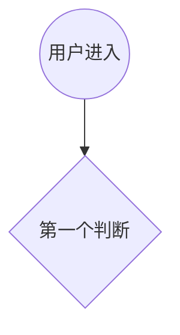

# {{产品名}} PRD

> 交付深度：{{交付深度}}
> 产品形态：
> 目标市场：
> 状态：草稿
> 标记：行尾的 `〔建议〕` 是还没确认的建议；`[待定 Q编号]` 是没定的问题，汇总在附录 A。

# 1. 背景与产品定位

## 1.1 项目背景

<!-- 三句话：现在有什么问题、现有的解法差在哪、我们要做什么。 -->

## 1.2 产品定位

- **核心理念**：
- **对标产品**：
- **目标用户**：
  - **B 端**：
  - **C 端**：

## 1.3 核心价值

<!-- 2～4 条，每条写「价值：靠什么实现」。 -->

1. 

## 1.4 目标市场

| 项 | 约定 |
|---|---|
| 主市场和次市场 | |
| 界面语言 | |
| 时区和格式 | |
| 登录渠道 | |
| 分享和任务渠道 | |
| 支付渠道 | |
| 合规要求 | |
| 设备和网络 | |

## 1.5 范围和优先级

- **这一版要做**：
- **这一版简化**：
- **这一版不做**：

# 2. 用户流程和状态

## 2.1 用户流程图

## 2.2 状态字典

| 维度 | 状态名 | 判断条件 | 备注 |
|---|---|---|---|
| | | | |

# 3. 产品前端页面描述

## 3.0 全局组件和通用规则

<!-- 先写对所有组件都成立的规矩，再写全局组件。 -->

**通用规则**

- 

### 3.0.1 

<!-- 从 templates/component-card.md 复制规格卡。 -->

## 3.1 

<!-- 一两句话：这是什么页面、从哪进来。 -->

**页面结构（大纲）**

<!-- 从顶到底。第一层是组件，末尾带节号；第二层往下是它的组成部分。 -->

- （3.1.1）

### 3.1.1 

<!-- 从 templates/component-card.md 复制规格卡。 -->

# 4. 给 AI 的交付约束

## 4.1 平台和技术约束

| 项 | 约定 |
|---|---|
| 做在什么端 | |
| 屏幕尺寸 | |
| 兼容范围 | |

## 4.2 后台配置总表

<!-- 不要手写。运行 prd.py config，各组件的配置项会汇总到这对标记中间。 -->

<!-- config:start -->
<!-- config:end -->

## 4.3 整页验收用例

### 用例 1：

- **前置条件**：
- **步骤**：
  1. 
- **期望结果**：
  - 

# 附录

## 附录 A 待定问题清单

| 编号 | 位置 | 问题 | 默认假设 | 状态 |
|---|---|---|---|---|

## 附录 B 决策记录

| 日期 | 决定了什么 | 谁定的 |
|---|---|---|
